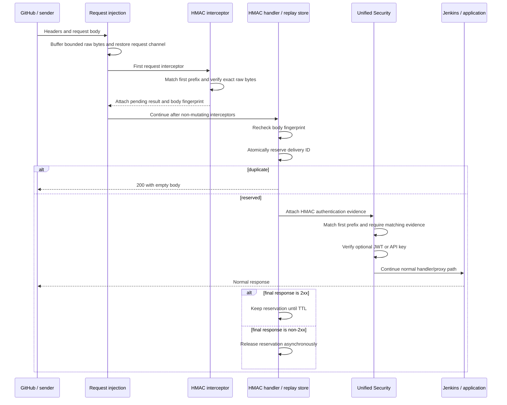

# HMAC Webhook Authentication for Java

Status: Implementation complete through Phase 4 local qualification for
`light-4j`. Release qualification still requires a deployed GitHub-to-Jenkins
environment and cross-runtime acceptance against the implemented Rust version;
controller fan-out remains an optional external integration. The first provider
profile is GitHub.

Tracking issue: [networknt/light-4j#2772](https://github.com/networknt/light-4j/issues/2772)

Companion design: `light-fabric/docs/src/design/hmac-webhook-authentication.md`
contains the Rust implementation design. The two implementations share an
external behavior contract, but deliberately use different internal designs.

## Decision Summary

The Java and Rust designs should remain separate.

`light-4j` is in maintenance mode and is widely deployed. Its implementation
should preserve the existing handler chain, first-match prefix behavior,
configuration reload pattern, and header-authentication code. In particular,
Java should not adopt Rust's new longest-prefix and method-aware policy model.

HMAC is a separate body-aware implementation component, but it is not a
separate route policy. Unified Security continues to decide which authentication
factors a path requires. A new `hmacProfile` property on an existing
`pathPrefixAuths` entry means that HMAC is required in addition to any supported
JWT or API-key requirement on that entry.

The proposed Java request chain is:

```text
RequestInterceptorInjectionHandler
  -> HmacRequestInterceptor (must be the first request interceptor)
  -> other non-mutating request interceptors
  -> HmacHandler (atomic replay gate)
  -> UnifiedSecurityHandler (HMAC evidence plus optional JWT/API key)
  -> application or proxy/Jenkins
```

The split between `HmacRequestInterceptor` and `HmacHandler` is intentional:

- the interceptor sees the exact pooled request bytes before parsing or
  transformation and performs the CPU-only signature verification; and
- the handler can suspend and resume the chain around an asynchronous
  distributed replay-store operation without blocking Undertow's I/O thread.

This adds a narrow extension to Unified Security and reuses the current request
buffering rather than replacing or duplicating it. It also adds an opt-in exact
byte limit to request injection for HMAC routes. The existing `maxBuffers`
behavior remains the default for legacy deployments.

## Resolved Requirements

- GitHub is the first provider. The design is configurable for other providers
  that sign a raw request body, but version 1 does not need another provider's
  integration tests.
- Version 1 supports HMAC-SHA-256 over the exact incoming entity-body bytes.
- A matched route can require HMAC only, HMAC and JWT, or HMAC and API key.
- A profile can use one shared secret or select an ordered secret list from a
  request header.
- GitHub uses `X-GitHub-Hook-ID` to select the secret list,
  `X-Hub-Signature-256` for the signature, and `X-GitHub-Delivery` for replay
  detection.
- Secrets are supplied through named environment variables. Secret values must
  not appear in config files, config snapshots, logs, metrics, or admin output.
- Active and previous secrets may overlap during rotation. Configuration reload
  can change which already-provisioned environment variables are referenced.
  Changing an environment variable's bytes requires a process restart.
- The exact verified request body and application headers continue through the
  normal handler/proxy path. HMAC code does not parse, normalize, decompress, or
  rewrite them.
- The exact maximum is configurable and defaults to 16 MiB.
- Non-identity `Content-Encoding` is rejected in version 1.
- Replay retention is configurable and defaults to seven days.
- Duplicate deliveries return an empty `200` and do not invoke Jenkins or the
  application handler.
- A final non-`2xx` response releases the replay reservation for a later retry.
- Replay storage is selected through the existing light-4j `service.yml`
  singleton binding. The HMAC artifact ships a copyable process-local binding
  fragment; each application must include it in its actual `service.yml`.
  Selecting a distributed implementation requires its artifact on the runtime
  classpath and a process restart; it never silently falls back to local storage
  when unavailable or misconfigured.
- An authorized operator can remove one replay record before requesting an
  intentional GitHub redelivery.
- Existing Java prefix matching and existing non-HMAC security configuration
  retain their current behavior.
- An HMAC-protected prefix cannot overlap `anonymousPrefixes`.

GitHub documents the relevant behavior in:

- [Validating webhook deliveries](https://docs.github.com/en/webhooks/using-webhooks/validating-webhook-deliveries)
- [Best practices for using webhooks](https://docs.github.com/en/webhooks/using-webhooks/best-practices-for-using-webhooks)
- [Redelivering webhooks](https://docs.github.com/en/webhooks/testing-and-troubleshooting-webhooks/redelivering-webhooks)

GitHub currently permits redelivery of deliveries from the previous three days
and uses the original `X-GitHub-Delivery` value for a redelivery. The seven-day
default therefore covers that manual redelivery window, while remaining
operator-configurable.

## Goals

- Reject a forged or altered GitHub request before it reaches Jenkins.
- Preserve the exact authenticated entity body for downstream processing.
- Compose HMAC with the existing JWT and API-key paths with minimal changes.
- Support one shared secret or a per-selector active/previous keyring.
- Suppress the same delivery atomically across concurrent requests.
- Support local and distributed replay stores without coupling replay safety to
  session CRUD semantics.
- Keep configuration and pre-provisioned secret-reference rotation reloadable.
- Fail closed when required buffering, HMAC enforcement, or a configured replay
  store is unavailable.
- Preserve existing Java handler and route-matching behavior for all legacy
  configurations.

## Non-Goals

- Do not implement a general canonical signing-expression language.
- Do not support signatures over timestamps, paths, query strings, or selected
  headers in version 1.
- Do not parse JSON or form data before HMAC verification.
- Do not verify a decompressed or reconstructed body.
- Do not preserve transport framing or hop-by-hop headers. Undertow and an
  existing proxy may normalize those independently of this feature.
- Do not add Java longest-prefix or method-aware Unified Security matching.
- Do not change the existing semantics of legacy `basic`, `jwt`, `sjwt`, `swt`,
  or `apikey` rules.
- Do not combine HMAC with Basic, SJWT, or SWT in version 1.
- Do not require another provider-specific integration test.
- Do not make Jenkins or another callee idempotent. The callee must still use an
  idempotency key where duplicate side effects are unacceptable.
- Do not use `SessionRepository.findById()` followed by `save()` as a replay
  fence; that sequence is not an atomic insert-if-absent operation.

## Threat Model and Security Invariants

The design addresses:

- request-body modification without the configured shared secret;
- missing, malformed, or ambiguous signature headers;
- selection of an unknown hook secret;
- repeated use of a GitHub delivery ID within the retention period;
- concurrent duplicates arriving at different application instances when a
  distributed store is configured;
- HMAC bypass through `anonymousPrefixes` or an incomplete handler chain;
- verification after a body parser or request transformer changed bytes; and
- partial authentication where HMAC succeeds but required JWT or API-key
  authentication fails.

The following invariants are mandatory:

1. HMAC input is the exact entity-body byte sequence captured from the incoming
   request.
2. No character decoding, JSON parsing, whitespace normalization, or
   decompression occurs before verification.
3. HMAC comparison is constant-time.
4. A route that declares `hmacProfile` cannot reach the application unless a
   matching HMAC evidence attachment is present.
5. Every configured factor passes before the request reaches Jenkins or an
   application handler.
6. The forwarded entity body has the same bytes and length as the body that was
   verified.
7. `X-GitHub-Hook-ID` only selects candidate secrets; it is not authenticated
   identity on its own.
8. Replay reservation is one atomic insert-if-absent operation.
9. Normal failure release uses an owner token so an old request cannot delete a
   newer reservation.
10. A configured replay-store failure fails closed.
11. Secret bytes never enter serializable module configuration or operational
    output.
12. One request pins one immutable HMAC runtime through verification,
    reservation, and completion handling.

### Replay Limitation

GitHub signs the request body, but it does not include `X-GitHub-Delivery` in
that HMAC. Following GitHub's recommendation and deduplicating the delivery
header blocks ordinary replay of an unchanged captured request, but it is not a
complete cryptographic anti-replay protocol. An attacker with a valid body and
signature could change the unsigned delivery header. Replay is also possible
after a finite retention period, after a local-store process restart, or during
ambiguous failures around downstream invocation.

For these reasons, replay suppression is defense in depth rather than a
substitute for callee idempotency. A future strict mode could also fence a
signature/body fingerprint, with the tradeoff that separate legitimate events
with identical bodies might be treated as duplicates.

## Why the Java Design Uses Two HMAC Components

The current `RequestInterceptorInjectionHandler` already performs bounded body
buffering, stores `PooledByteBuffer[]` under
`AttachmentConstants.BUFFERED_REQUEST_DATA_KEY`, restores the request channel,
and then calls registered `RequestInterceptor` instances in their `service.yml`
order. This is the smallest safe place to observe the raw body.

`maxBuffers` alone cannot be the HMAC security boundary. When the last configured
buffer becomes full, the current reader can stop before it has observed
end-of-stream. A signature verifier must never authenticate that buffered prefix
and then allow unread bytes to continue downstream. HMAC deployments therefore
enable a new exact `maxBodyBytes` request-injection option. In that mode the
reader must observe EOF at or below the limit, or read/probe one byte beyond the
limit and return `413`. The option is absent or zero by default so existing
non-HMAC deployments keep their current behavior.

However, `RequestInterceptor.handleRequest()` is synchronous. A Redis or other
distributed atomic reservation may require asynchronous I/O and must not block
the Undertow I/O thread. Changing the general request-interceptor contract would
affect established modules and is not appropriate for the Java maintenance
branch.

The responsibilities are therefore split:

| Component | Responsibility |
|---|---|
| `HmacRequestInterceptor` | Match an HMAC rule, validate method/headers/encoding/body limit, verify the raw bytes, and attach an immutable pending result. It performs no network I/O. |
| `HmacHandler` | Require the pending result, atomically reserve the replay key through the injected asynchronous replay-store service, return local `200` for a duplicate, or attach final authentication evidence and continue. |
| `UnifiedSecurityHandler` | Match the existing first prefix, require evidence for `hmacProfile`, then enforce an optional JWT or API key with existing code. |

Although `HmacHandler` is an independent handler-chain component, Unified
Security owns the route policy and composition. There is no second HMAC route
list.

## Unified Security Configuration

Add one nullable property to `UnifiedPathPrefixAuth`:

```yaml
pathPrefixAuths:
  # Existing configuration remains unchanged.
  - prefix: /legacy-api
    jwt: true
    jwkServiceIds:
      - com.networknt.oauth2-token-1.0.0

  # HMAC only.
  - prefix: /github-webhook
    hmacProfile: github

  # HMAC and JWT. Both are required.
  - prefix: /partner-webhook
    hmacProfile: partner
    jwt: true
    jwkServiceIds:
      - com.networknt.oauth2-partner-1.0.0

  # HMAC and API key. Both are required.
  - prefix: /signed-build
    hmacProfile: build-system
    apikey: true
```

`hmacProfile` both enables HMAC and names the profile; a separate boolean is not
needed. An HMAC rule may contain:

- no legacy auth boolean, meaning HMAC only;
- `jwt: true`, meaning HMAC and JWT; or
- `apikey: true`, meaning HMAC and API key.

For an HMAC rule, configuration loading rejects Basic, SJWT, SWT, or both JWT
and API key. This avoids changing the existing Authorization-header-versus-API-
key branch behavior. These restrictions apply only to new HMAC rules; legacy
rules are not reinterpreted.

### First-Match Compatibility

Java keeps the current ordered, first-prefix-match behavior. It does not sort by
prefix length and does not add method-aware matching.

New validation applies only when HMAC is configured:

- reject any overlap between an HMAC prefix and an earlier first-match rule,
  including an earlier rule that is more specific than the HMAC prefix;
- reject an unknown or blank HMAC profile;
- reject an HMAC prefix that overlaps any `anonymousPrefixes` value;
- reject an HMAC prefix not covered by
  `request-injection.appliedBodyInjectionPathPrefixes`;
- reject a built-in request-transformer prefix that overlaps an HMAC route; and
- require `HmacRequestInterceptor` to be the first configured
  `RequestInterceptor`.

The existing prefix ordering remains authoritative. Operators should use a
dedicated webhook path and place more specific rules before broader rules, just
as they do today.

### Method Handling

Version 1 does not add methods to the Unified Security matcher. Each HMAC
profile instead has an `allowedMethods` list, defaulting to `POST`. The allowed
values are limited to `POST`, `PUT`, and `PATCH`, matching the methods for which
`RequestInterceptorInjectionHandler` currently buffers content. A disallowed
method on an HMAC-matched prefix returns `405`.

GitHub qualification uses `POST` only.

## HMAC Profile Configuration

`hmac.yml` contains provider profiles and replay policy. It does not select a
replay-store implementation and does not contain route prefixes. The store
implementation is selected through `service.yml`.

```yaml
enabled: true

profiles:
  github:
    signedInput: rawBody
    algorithm: hmacSha256
    allowedMethods:
      - POST
    signatureHeader: X-Hub-Signature-256
    signaturePrefix: "sha256="
    signatureEncoding: hex
    maxBodyBytes: 16777216

    secrets:
      selectorHeader: X-GitHub-Hook-ID
      bySelector:
        "12345678":
          - GITHUB_HOOK_12345678_CURRENT_SECRET
          - GITHUB_HOOK_12345678_PREVIOUS_SECRET
        "87654321":
          - GITHUB_HOOK_87654321_CURRENT_SECRET
      defaultEnvNames: []

    replay:
      enabled: true
      idHeader: X-GitHub-Delivery
      retentionSeconds: 604800

  shared-build-system:
    signedInput: rawBody
    algorithm: hmacSha256
    allowedMethods:
      - POST
    signatureHeader: X-Build-Signature
    signaturePrefix: ""
    signatureEncoding: base64
    maxBodyBytes: 16777216
    secrets:
      selectorHeader: ""
      bySelector: {}
      defaultEnvNames:
        - BUILD_WEBHOOK_CURRENT_SECRET
        - BUILD_WEBHOOK_PREVIOUS_SECRET
    replay:
      enabled: true
      idHeader: X-Build-Delivery
      retentionSeconds: 604800
```

Version 1 uses exactly one replay-store service per JVM. Applications can copy
the supplied fragment to select the bounded local implementation:

```yaml
# service.yml
singletons:
  - com.networknt.hmac.WebhookReplayStore:
      - com.networknt.hmac.LocalWebhookReplayStore:
          maxEntries: 100000
```

A deployment that includes the optional Redis adapter switches the binding
without rebuilding the application JAR:

```yaml
# service.yml
singletons:
  - com.networknt.hmac.WebhookReplayStore,com.networknt.server.StartupHookProvider,com.networknt.server.ShutdownHookProvider:
      - com.networknt.hmac.redis.RedisWebhookReplayStore:
          urlEnv: WEBHOOK_REPLAY_REDIS_URL
          keyPrefix: "light:hmac-replay:"
          connectTimeoutMillis: 1000
          operationTimeoutMillis: 1000
```

The selected implementation class and all of its dependencies must already be
on the runtime classpath. `SingletonServiceFactory` constructs `service.yml`
bindings once per JVM, so changing the binding requires a restart. Reloading
`hmac.yml` may change profile retention and secret references, but cannot switch
the store implementation in a running process.

Version 1 supports:

| Field | Values and behavior |
|---|---|
| `signedInput` | `rawBody` only |
| `algorithm` | `hmacSha256` only |
| `allowedMethods` | Non-empty subset of `POST`, `PUT`, and `PATCH`; default `POST` |
| `signatureEncoding` | `hex` or `base64` |
| `signaturePrefix` | Exact optional prefix removed before signature decoding |
| `maxBodyBytes` | Positive byte limit, default 16 MiB |
| `selectorHeader` | Optional exact secret-map selector header |
| `defaultEnvNames` | Explicit shared-secret fallback; empty means no fallback |
| `idHeader` | Required replay identifier header when replay is enabled |
| `retentionSeconds` | Positive TTL; default seven days |

HTTP header names are case-insensitive. Multiple values for the signature,
selector, or replay ID header are rejected instead of choosing one. Selector
values are matched exactly after trimming optional HTTP whitespace and are not
converted to numbers.

The candidate secret list is ordered active first, previous second. Limit the
list to two entries in version 1. Verification computes and compares every
candidate instead of returning at the first match, reducing secret-version
timing differences.

If `selectorHeader` is present, an unknown or missing selector fails unless
`defaultEnvNames` is explicitly non-empty. Shared-secret fallback is therefore
an operator decision, not an implicit convenience behavior.

## Secret Resolution and Rotation

Serialized configuration contains environment-variable names only. Runtime
compilation resolves those names into non-serializable key material with
redacted `toString`, logging, and management representations.

Startup or a newly loaded runtime fails closed if a referenced environment
variable is missing, empty, or cannot initialize the configured `Mac`.
Deployments should use randomly generated secrets of at least 32 bytes when the
provider permits it.

Recommended rotation is:

1. Provision both `CURRENT` and `PREVIOUS` environment variables before process
   startup.
2. Configure the ordered list as `[CURRENT, PREVIOUS]` and reload `hmac.yml`.
3. Change the provider to use `CURRENT`.
4. After the overlap window, remove `PREVIOUS` from `hmac.yml` and reload.
5. Use a rolling restart when the bytes assigned to an environment variable
   must change.

One immutable `HmacRuntime` is attached to each matched request. A reload does
not change a request's secret keyring or replay-store reference halfway through
processing.

## Handler and Service Wiring

The HMAC module uses the existing request-injection handler:

```yaml
# handler.yml
handlers:
  - com.networknt.handler.RequestInterceptorInjectionHandler@request-injection
  - com.networknt.hmac.HmacHandler@hmac
  - com.networknt.security.UnifiedSecurityHandler@unified-security
  # application/proxy handlers follow

chains:
  webhook:
    - request-injection
    - hmac
    - unified-security
    - proxy
```

The HMAC interceptor must be first in the singleton list:

```yaml
# service.yml
singletons:
  - com.networknt.handler.RequestInterceptor:
      - com.networknt.hmac.HmacRequestInterceptor
      - com.networknt.body.RequestBodyInterceptor
```

Configure request injection for every HMAC prefix:

```yaml
# request-injection.yml
enabled: true
maxBuffers: 1024
maxBodyBytes: 16777216
appliedBodyInjectionPathPrefixes:
  - /github-webhook
  - /partner-webhook
  - /signed-build
```

The existing `maxBuffers` setting remains an allocation guard. The new optional
request-injection `maxBodyBytes` is the strict read boundary and must be positive
when any covered route requires HMAC. The body reader counts every byte across
buffer boundaries, reads until EOF, and rejects as soon as it observes byte
`maxBodyBytes + 1`. A declared `Content-Length` above the limit can be rejected
before reading, but chunked and missing-length requests still use the counted
limit.

The HMAC interceptor independently checks its profile `maxBodyBytes`. Startup
validation requires the request-injection limit to be greater than or equal to
every covered HMAC profile limit and verifies that `maxBuffers` can hold that
many bytes with the configured server buffer size. This prevents a prefix-only
HMAC check and preserves an exact 16 MiB acceptance boundary.

`handler.yml` and `service.yml` wiring is initialized at startup. Enabling HMAC
for the first time therefore requires deploying the module and restarting the
process. After it is pre-wired, profile, prefix-coverage, secret-reference, and
Unified Security changes use the existing module config-reload path.

### Request Transformer Restriction

`RequestTransformerInterceptor` can replace the buffered request body and
change the path or headers. That is incompatible with forwarding the exact body
that GitHub signed.

Built-in configuration validation rejects overlap between an HMAC route and
`request-transformer.appliedPathPrefixes`. A custom request interceptor on an
HMAC route must be non-mutating. As a defense-in-depth check, the HMAC
interceptor records the original body length and a SHA-256 body fingerprint;
`HmacHandler` recomputes them before replay reservation and rejects the request
if another interceptor changed the buffered body.

## Java Request Lifecycle



Detailed flow:

1. `RequestInterceptorInjectionHandler` applies its existing POST/PUT/PATCH and
   prefix checks, reads the complete body under the opt-in exact byte limit,
   stores the pooled-buffer attachment, restores the Undertow request channel,
   and invokes request interceptors.
2. `HmacRequestInterceptor`, which is first, resolves the first matching Unified
   Security rule. It is a no-op when that rule has no `hmacProfile`.
3. For HMAC, it validates the method, content encoding, required single-value
   headers, exact body limit, signature syntax, secret selector, and HMAC.
4. It reads each `ByteBuffer.duplicate()` without changing the pooled buffer's
   position or limit. It does not allocate a second 16 MiB byte array.
5. On success it attaches an immutable pending result containing the matched
   prefix, profile, selector namespace, replay ID, original path, body length,
   body fingerprint, and pinned `HmacRuntime`. It never attaches a secret or
   submitted signature.
6. Other configured request interceptors run. HMAC routes may use parsers that
   only attach derived data; they may not mutate the buffered request.
7. `HmacHandler` returns immediately if an earlier interceptor already started
   an error response. Otherwise, it requires the pending result for an HMAC
   rule, rechecks the body length/fingerprint, and calls the replay store
   asynchronously.
8. A duplicate gets an empty local `200`; the remaining chain and callee are not
   invoked. This is an idempotency response, not admission of the request to the
   protected route.
9. A new reservation produces an HMAC evidence attachment and resumes the
   handler chain.
10. `UnifiedSecurityHandler` uses its existing first-match logic. For an HMAC
    rule it requires evidence with the same prefix and profile before running
    existing JWT or API-key verification.
11. Existing body restoration forwards the same entity bytes through the
    application or proxy path. The HMAC components only read headers.
12. An exchange completion listener retains the reservation for a final `2xx`
    and schedules owner-checked release for a final non-`2xx`.

If any required component is absent or out of order, the evidence is missing
and Unified Security returns `503`; it must never treat a configured HMAC factor
as optional.

### Duplicate Before Header Authentication

The replay gate precedes Unified Security so that the latter can enforce the
presence of final HMAC evidence and fail closed on chain misconfiguration. A
cryptographically valid duplicate can therefore receive the configured empty
`200` before JWT or API-key verification. It still cannot reach the callee and
does not create authenticated request context. This is the narrow Java
maintenance-mode tradeoff for avoiding a rewrite of the synchronous Unified
Security handler.

If policy requires rejecting duplicates that do not also carry a current JWT
or API key, the handler order would need a broader split of Unified Security
into selection/header-auth/finalization phases. That is explicitly deferred.

## HMAC Verification

The interceptor performs these checks in order:

1. Resolve the existing first matching prefix and HMAC profile.
2. Reject a method not in `allowedMethods` with `405`.
3. Reject `Content-Encoding` other than absent or `identity` with `415`.
4. Count the attached raw bytes and return `413` if they exceed
   `maxBodyBytes`.
5. Require exactly one signature header, remove the configured exact prefix,
   decode hex or base64, and require a 32-byte SHA-256 HMAC.
6. Resolve the ordered candidate secrets using the optional selector header.
7. Compute `HmacSHA256` over the unmodified duplicated buffers for every
   candidate.
8. Compare each expected value with `MessageDigest.isEqual` and do not return
   early when one secret matches.
9. Require exactly one replay ID header when replay is enabled.
10. Return one generic `401` for a missing signature, malformed signature,
    unknown selector, missing replay ID, or signature mismatch.

An empty body is the zero-length HMAC input. Missing buffered data is treated as
an empty body only when Undertow reports that the request is complete and its
declared content length is zero; otherwise it is a server wiring error and
fails closed.

Java version 1 relies on the existing server/request read timeout while
`RequestInterceptorInjectionHandler` collects the body. It does not add a new
HMAC-specific body-read timer to this shared production handler.

## Replay Store Service

Replay behavior needs a purpose-specific asynchronous service contract:

```java
public interface WebhookReplayStore {
    CompletionStage<ReserveOutcome> reserve(
        WebhookReplayKey key,
        Duration retention
    );

    CompletionStage<Void> release(ReplayReservation reservation);

    CompletionStage<Boolean> forceRemove(WebhookReplayKey key);
}
```

`HmacRuntime` resolves this service with
`SingletonServiceFactory.getBeans(WebhookReplayStore.class)`, requires exactly
one implementation, and pins that singleton in each immutable runtime. If any
enabled profile uses replay and the binding is missing, duplicated, cannot be
constructed, or reports an invalid configuration, HMAC startup/runtime
compilation fails closed. There is no implicit local fallback. The provided
application template obtains default local behavior by explicitly binding
`LocalWebhookReplayStore`.

The service interface remains in the core HMAC artifact. Local and Redis are
separate implementation classes, and the Redis implementation remains in an
optional artifact. An implementation that owns a client or cleanup executor may
also implement light-4j `StartupHookProvider` and `ShutdownHookProvider`; the
interfaces must be listed together in the same comma-separated `service.yml`
key so `SingletonServiceFactory` shares one implementation object and the
existing server lifecycle initializes and closes that object.

`ReserveOutcome` is either `Reserved`, containing an opaque reservation with a
random owner token, or `Duplicate`. The logical key contains the profile,
normalized selector or `shared`, and replay ID. A provider may hash that tuple
before persistence.

The provider contract requires:

- atomic insert-if-absent with TTL;
- owner-token compare-and-delete for normal release;
- unconditional, authorized deletion for operator redelivery;
- bounded connection and operation timeouts; and
- no blocking of the Undertow I/O thread.

The existing `light-session-4j` implementations are useful models for local,
Redis, Hazelcast, or JDBC lifecycle and configuration, but the current
`SessionRepository` create/save/find/delete contract does not provide the atomic
reservation semantics required here. Replay-store adapters may reuse underlying
clients, but must implement this stronger contract directly.

### Local Store

Applications selecting the process-local implementation bind the supplied
`LocalWebhookReplayStore` fragment in their own `service.yml`. The store must:

- use atomic `putIfAbsent` semantics;
- support a TTL per reservation;
- have a configured maximum entry count;
- never silently evict an unexpired entry to make room;
- return an unavailable/capacity result, producing `503`, when the guarantee
  cannot be maintained; and
- expose only safe size/outcome summaries to operational tooling.

Local state is lost on restart and is not shared across instances. Startup and
metrics must clearly state `scope=local`. Operators running multiple Java
instances should configure a distributed store.

### Distributed Store

The first optional distributed adapter should be Redis and should remain a
separate artifact so the core HMAC module does not add Redisson or another
client to every `light-4j` deployment.

Reservation maps to `SET key owner-token NX PX retention`. Release uses an
atomic compare-and-delete script, and operator removal uses `DEL`. The Redis
namespace must not evict unexpired replay records. Timeout, connection failure,
or a full store returns `503`; it never falls back to local storage for that
request.

Whether the adapter is packaged in `light-4j` or alongside reusable providers
in `light-session-4j` is a repository-layout decision, not a change to the
service contract or its `service.yml` binding.

### Retention and Final Outcome

The default retention is 604800 seconds (seven days). Each profile can override
it. Finite retention means finite replay protection.

| Outcome | Reservation behavior |
|---|---|
| Duplicate before the callee | Return empty `200`; keep the existing reservation |
| Final `2xx` | Keep until TTL, even if the caller disconnects afterward |
| Final non-`2xx` | Schedule owner-checked release |
| Handler/proxy exception before a response | Schedule owner-checked release from exchange completion |
| Release failure | Log/count it and retain the original response; operator may remove the stale record |
| JVM crash after reserve | Reservation remains until TTL or operator removal |

Java's exchange completion callback makes release asynchronous and eventually
consistent. A retry arriving immediately after a failed response can briefly
observe the still-present reservation and receive duplicate `200`. The release
operation must be dispatched promptly and measured. Removing this small window
would require response-commit changes across the established Java chain and is
not proposed for maintenance mode.

## Operator Redelivery

Add an optional protected admin handler rather than requiring operators to
construct an internal cache key:

```http
POST /adm/hmac-replay/remove
Content-Type: application/json

{
  "profile": "github",
  "selector": "12345678",
  "deliveryId": "6f3f8b40-..."
}
```

The response reports whether an entry was removed and whether the store is
local or distributed. It never returns the provider key, stored owner token, or
secret material.

This handler is disabled by default, requires the existing administrative
authorization controls, and emits an audit event. For a local store the
controller must invoke it on every instance that can serve the route. One call
is sufficient for a shared distributed store. The operator workflow is remove
first, then ask GitHub to redeliver.

## Configuration Reload

The module follows the current `Config.load()` identity-based pattern:

- `HmacConfig.load()` returns a new immutable config after its mapped config is
  cleared and reloaded;
- `HmacRuntime.load()` obtains the already-constructed
  `WebhookReplayStore` singleton from `SingletonServiceFactory`, compiles the
  profiles, and atomically publishes a runtime for that config identity; and
- the interceptor attaches the chosen runtime to the request so in-flight work
  continues consistently after another reload.

`service.yml` is not part of this hot-reload path because
`SingletonServiceFactory` builds its service map during static initialization.
A local-to-Redis or Redis-to-local change therefore requires a process restart.
The new process must fail startup if the selected class, dependency, or provider
configuration is unavailable; it must not preserve availability by substituting
the local implementation.

Invalid newly loaded HMAC configuration fails closed for affected new requests
and does not alter in-flight requests. Error logs identify the profile and
field, but never the selector value, environment value, signature, or body.

Secret-only rotation changes `hmac.yml` and reloads the HMAC module. Adding a
new protected route should be staged:

1. deploy and restart once with the HMAC handler/interceptor wiring present;
2. add the profile and request-injection prefix, then reload those modules; and
3. add `hmacProfile` to the Unified Security rule and reload Unified Security.

Disabling reverses that order: remove the Unified HMAC requirement first, then
remove unused buffering/profile configuration. A request that observes a mixed
configuration during staged reload either validates against one pinned runtime
or fails closed; it cannot proceed with partial HMAC evidence.

## Failure Contract

| Condition | HTTP status | Behavior |
|---|---:|---|
| Method not allowed by profile | `405` | Reject without replay reservation or callee invocation |
| Missing/malformed signature, unknown selector, or mismatch | `401` | Generic invalid webhook authentication response |
| Missing/malformed replay ID when enabled | `401` | Reject without reservation or callee invocation |
| Unsupported `Content-Encoding` | `415` | Reject without verification or forwarding |
| Body exceeds exact profile limit or request-injection limit | `413` | Reject and do not invoke the callee |
| Duplicate replay ID | `200` | Empty local response; do not invoke Unified Security or the callee |
| Configured replay store unavailable/full | `503` | Fail closed; do not invoke the callee |
| Missing/mismatched HMAC evidence or invalid chain wiring | `503` | Fail closed as server configuration error |
| Buffered body changed after verification | `500` | Reject as incompatible middleware configuration |
| Optional JWT/API key fails | Existing Unified Security status | Release reservation on completion; do not invoke the callee |
| Callee returns non-`2xx` | Callee status | Forward response and release reservation asynchronously |
| Callee/handler throws | Existing error mapping | Release reservation from completion handling |

Authentication error responses do not reveal whether a selector exists, which
secret matched, or whether active versus previous material was used.

## Observability

Recommended metrics are:

- `hmac_webhook_requests_total{profile,outcome}` where outcome is `accepted`,
  `duplicate`, `invalid`, `too_large`, `unsupported_encoding`,
  `store_unavailable`, `runtime_error`, or `chain_error`;
- `hmac_webhook_verification_duration_seconds{profile}`;
- `hmac_webhook_body_bytes{profile}`;
- `hmac_replay_operations_total{store_type,operation,outcome}`; and
- `hmac_replay_local_entries`.

Logs may include the profile, matched prefix, correlation ID, store type, final
status, an optional one-way truncated hash of the replay tuple, and the
exception type/stack for an unexpected runtime failure. They must not include
the body, signature, secret, raw selector, replay ID, JWT, or API key. Selector
and replay ID must not be metric labels.

Startup and reload output identifies local versus distributed replay scope. A
local store should produce a warning when the deployment declares more than one
instance.

## Validation Plan

### Compatibility and Configuration

- Run all existing Unified Security tests without changing legacy fixtures.
- Prove the current first-match behavior is unchanged for non-HMAC rules.
- Accept HMAC-only, HMAC-plus-JWT, and HMAC-plus-API-key configurations.
- Reject unsupported HMAC factor combinations, unknown profiles, shadowed HMAC
  prefixes, anonymous overlap, missing request-injection coverage, transformer
  overlap, and wrong interceptor order.
- Prove missing handler/interceptor wiring fails closed rather than bypassing
  HMAC.
- Prove an interceptor error cannot continue through the asynchronous body-read
  branch to Unified Security or the callee.
- Prove an in-flight request continues with its pinned runtime during reload.
- Prove missing/empty environment variables fail without exposing values.
- Prove `service.yml` selects local and Redis implementations without changing
  HMAC consumer code, and that a missing or invalid binding fails closed.
- Prove changing `hmac.yml` cannot replace the injected replay-store singleton;
  provider changes take effect only after restart.

### Cryptography and Raw Bytes

- Use GitHub's published secret/payload/signature test vector.
- Test non-ASCII UTF-8 payload bytes, whitespace-only differences, empty bodies,
  invalid hex/base64, wrong prefixes, wrong decoded lengths, and duplicate
  signature headers.
- Split the same body across different Undertow buffer boundaries and get the
  same HMAC result.
- Verify active and previous secrets while never reporting which matched.
- Prove logically equivalent JSON with different bytes does not validate.
- Prove a request body parser may attach parsed data without changing forwarded
  bytes.
- Prove a body mutation after verification is detected before replay reservation
  or callee invocation.

### Authentication Composition

- HMAC-only requires valid HMAC evidence.
- HMAC plus JWT requires both factors.
- HMAC plus API key requires both factors.
- Valid HMAC cannot compensate for missing/invalid JWT or API key.
- Valid JWT/API key cannot compensate for invalid HMAC.
- HMAC rules cannot bypass through `anonymousPrefixes`.
- A duplicate returns `200` without invoking the callee.

### Body and Handler Integration

- Accept exactly 16 MiB and reject 16 MiB plus one byte.
- Prove a body that fills the last configured buffer is accepted only after EOF
  is observed, while any unread suffix produces `413` and is never forwarded.
- Test `Content-Length` and chunked requests over HTTP/1.1 and HTTP/2.
- Reject non-identity content encoding.
- Use a counting fake callee to prove no request arrives for invalid HMAC,
  duplicate ID, store failure, oversized body, incompatible transformation, or
  missing authentication evidence.
- Prove the fake callee receives the exact authenticated bytes and expected
  end-to-end application headers.
- Prove distributed reservation and chain continuation do not block the
  Undertow I/O thread.

### Replay

- Race many reservations for one key; exactly one wins in the local and Redis
  implementations.
- Keep a reservation after `2xx`.
- Release after Unified Security failure, non-`2xx`, and handler/proxy failure.
- Prove owner-checked release cannot delete a newer reservation.
- Fail closed on local capacity exhaustion and Redis outage.
- Confirm a JVM restart loses local state and does not lose distributed state.
- Confirm operator removal permits intentional redelivery.
- If controller integration is deployed, confirm its fan-out removes local
  entries on every selected instance. This is not part of the core Java module.

### GitHub-to-Jenkins Qualification

- Configure one GitHub hook ID with an active secret and trigger one Jenkins
  build.
- Confirm Jenkins receives the original body and GitHub application headers.
- Send the same delivery again and confirm an empty `200` with no second build.
- Make Jenkins return failure, wait for release, and redeliver successfully.
- Remove the replay entry administratively and perform an intentional GitHub
  redelivery.
- Rotate active/previous secret references through module reload.
- No other provider-specific integration test is required.

## Implementation Phases

### Phase 0: Prove the Maintenance-Mode Integration Points

- Build a focused fixture around `RequestInterceptorInjectionHandler` with a
  counting downstream handler.
- Prove the first interceptor sees the exact pooled bytes without advancing
  buffer positions.
- Add the opt-in exact request-injection limit and prove the handler cannot
  authenticate only a full-buffer prefix while unread bytes remain.
- Prove a following `HmacHandler` can await an asynchronous reservation and
  resume the chain without blocking an I/O thread.
- Prove an exchange completion listener observes the final application/proxy
  status and releases failures.
- Prove body fingerprint revalidation detects `RequestTransformerInterceptor`
  mutation.

If these assertions fail, stop and choose a dedicated buffered HMAC handler.
Changing the general `RequestInterceptor` contract is not the fallback for the
maintenance branch.

Phase 0 was completed in the `light-4j` `handler` module on 2026-08-26. The
focused `HmacPhase0IntegrationTest` proves all of the assertions above with a
real Undertow server and a counting downstream handler. The production
`RequestInterceptorInjectionHandler` now supports an opt-in `maxBodyBytes`
limit: a positive value requires EOF at or below the limit and returns `413`
after observing the first excess byte, while zero preserves the legacy
`maxBuffers` behavior. HMAC startup validation verifies that `maxBuffers` can
retain the configured exact byte limit. The boundary fixture uses the default
16 MiB HMAC limit and proves that exactly 16 MiB is accepted while the first
excess byte is rejected.

A handler-chain regression fixture also sends repeated requests through one
singleton `RequestInterceptorInjectionHandler` at different positions in two
configured paths. Each exchange resolves and retains its own continuation;
the handler instance never caches a successor discovered from `handler.yml`.

The asynchronous proof established the Undertow lifecycle contract for the
production `HmacHandler`: call `exchange.dispatch()` before returning while the
reservation is pending, and call `exchange.dispatch(HttpHandler)` from the
completion callback to resume the chain. This keeps the I/O thread
non-blocking, prevents premature exchange completion, and lets an exchange
completion listener observe the final downstream status. The same fixture also
proves that duplicate-buffer reads preserve pooled-buffer positions and that a
post-verification in-place body mutation fails fingerprint revalidation before
reservation or downstream invocation. A dedicated buffered HMAC handler is not
required.

### Phase 1: Configuration and Verification Core

- Add `hmac-config` and `hmac` modules.
- Add `hmacProfile` to `UnifiedPathPrefixAuth` and its config schema.
- Implement profile validation, environment resolution, immutable runtime
  loading, raw-buffer HMAC verification, and redacted representations.
- Add focused config, crypto, byte-boundary, and reload tests.

Phase 1 was completed in `light-4j` on 2026-08-26. The new `hmac-config` module
loads and validates named profiles while retaining only environment-variable
references in configuration. The new `hmac` module resolves those references
into immutable, atomically replaceable runtime snapshots, verifies HMAC-SHA256
against duplicate views of the exact pooled request buffers, uses constant-time
signature comparison, and keeps secrets and authentication material out of
string representations. A failed reload leaves the prior snapshot available to
requests that already pinned it.

`UnifiedPathPrefixAuth` and its generated schema now expose `hmacProfile`.
Startup validation rejects unknown profiles, unsupported authentication-factor
combinations, shadowed first-match rules, anonymous overlaps, and request
injection configurations whose exact-body limit or pooled-buffer capacity is
too small for an HMAC profile. Focused tests cover configuration failures,
GitHub-compatible hex signatures, base64 signatures, active/previous key
rotation, selector headers, replay identifiers, malformed and duplicate
headers, empty and exact-boundary bodies, UTF-8 bytes, content encodings,
oversize bodies, buffer-position preservation, runtime reload, and redaction.
The replay store, replay administration, chain wiring, and Unified Security
evidence consumption were completed in Phases 2 and 3.

The structural HMAC-rule checks live in `UnifiedSecurityConfig`, so unsafe
anonymous overlap, first-match shadowing, blank profiles, and unsupported factor
combinations fail during Unified Security configuration loading even when the
HMAC artifacts or `service.yml` bindings are absent.

### Phase 2: Replay Service and Administration

- Add the asynchronous `WebhookReplayStore` service interface and bounded local
  implementation.
- Supply a local implementation fragment for applications to copy into
  `service.yml` and resolve it with `SingletonServiceFactory`.
- Add an optional Redis implementation using atomic reserve and
  compare-and-delete, selected by changing the `service.yml` binding and
  restarting with the adapter artifact on the classpath.
- Add the protected replay-removal admin handler.
- Add binding, startup-failure, concurrency, outage, capacity, release, and
  operator-removal tests.

Phase 2 was completed in `light-4j` on 2026-08-26. The core `hmac` artifact now
contains the asynchronous `WebhookReplayStore` contract, opaque owner-token
reservations, one-way replay-key representations, safe operational summaries,
and a bounded `LocalWebhookReplayStore`. The local implementation performs
atomic insert-if-absent, tracks each reservation's TTL, never evicts an
unexpired entry for capacity, fails closed when full, and uses owner-checked
release so a stale completion cannot remove a newer reservation.

`HmacRuntimeManager` resolves exactly one replay provider from
`SingletonServiceFactory`, validates it, and pins the same singleton across
`hmac.yml` reloads. Missing, duplicate, or invalid bindings fail runtime
compilation without an implicit local fallback. The supplied
`hmac-service.yml` fragment shows the default local binding; applications copy
that entry into their `service.yml`.

The optional `hmac-redis` artifact supplies `RedisWebhookReplayStore` without
adding Redisson to core HMAC deployments. It uses atomic Redis scripts for
reserve, owner-checked release, and operator removal, hashes the logical replay
tuple before persistence, applies bounded connection and operation timeouts,
and participates in the existing startup/shutdown hook lifecycle through one
comma-separated `service.yml` binding. Redis failures complete exceptionally
and are mapped by the HMAC chain to `503`; they never fall back to local state.

The optional `HmacReplayAdminHandler` implements protected-route operation
`POST /adm/hmac-replay/remove`, returns only `removed` and store `scope`, and
adds safe audit fields without exposing selectors, delivery IDs, storage keys,
or owner tokens. It is not present in the default handler chain; an application
that enables it must wire the exact route behind its existing administrative
authentication and authorization controls. The same handler works for local
and distributed providers, allowing the controller to fan out local removals
or issue one removal to a shared Redis store.

Focused tests cover local and distributed reservation races, TTL and capacity,
owner-checked release, process-local restart loss, distributed restart
retention, missing/duplicate/invalid bindings, provider pinning across reload,
Redis outage behavior, shared lifecycle binding, redacted representations, and
audited operator removal. Phase 3 consumes that service through the pinned
request runtime and owns request-chain admission and final-outcome release.

### Phase 3: Unified Security and Handler Integration

- Add HMAC evidence attachment/checking to Unified Security without changing
  legacy branches.
- Add `HmacRequestInterceptor` and `HmacHandler` wiring validation.
- Add completion-based reservation outcome handling, metrics, and redacted
  logging.
- Add chain-misconfiguration and exact-forwarding integration tests.

Phase 3 was completed in `light-4j` on 2026-08-26. `HmacHandler` now validates
the pending result against the current first-match Unified Security rule,
recomputes the buffered body length and SHA-256 fingerprint, and performs the
atomic replay reservation through the request's pinned asynchronous store. It
dispatches before awaiting the store, resumes on an Undertow worker, returns an
empty local `200` for duplicates, and attaches an opaque final
`HmacAuthenticationEvidence` only after admission. A completion listener keeps
successful `2xx` reservations and schedules owner-checked release for all other
final statuses without changing the original response when release fails.

`UnifiedSecurityHandler` now requires matching HMAC evidence only when the
selected rule has `hmacProfile`; its existing anonymous, Basic, JWT, SJWT, SWT,
and API-key branches are otherwise unchanged. HMAC-only routes therefore need
no Authorization or API-key header, while an HMAC-plus-JWT or HMAC-plus-API-key
rule continues into the existing second-factor branch after evidence is
accepted. Missing or mismatched evidence fails closed with `503`, and a body
mutation after verification fails with `500` before reservation or downstream
invocation.

Startup wiring checks require `HmacRequestInterceptor` to be the first
`RequestInterceptor`, reject overlap with built-in request-transformer paths,
and require `HmacHandler` to be immediately before `UnifiedSecurityHandler`.
Interceptor order is validated during startup because `service.yml` bindings
are immutable for the running process. Full integration validation is memoized
by the loaded configuration/runtime identities and reruns only after a relevant reload.
Handler adjacency is validated against each materialized `handler.yml` path or
default chain after disabled middleware has been removed. This uses the active
`HandlerConfig` instance, including configurations selected through
`Handler.setConfig(...)`, rather than reloading the default `handler.yml`.
The supplied `hmac-service.yml` fragment includes both the interceptor and the
default local replay-store bindings. Metrics cover verification duration, body
size, bounded request outcomes, replay operations, and local entry count.
Unexpected failures use a distinct `runtime_error` outcome and retain the
throwable for diagnosis without logging authentication material.

Focused real-Undertow tests prove asynchronous continuation, byte-exact UTF-8
forwarding, duplicate suppression, `2xx` retention, non-`2xx` release and
redelivery, release after an authentication rejection or thrown downstream
handler, body-mutation rejection, missing interceptor/evidence failure, wrong
interceptor order, and wrong adjacent-handler rejection before and after HMAC
enablement. Unified Security integration tests prove that final evidence admits
an HMAC-only route without legacy credentials, that a valid HMAC cannot replace
a required JWT or API-key factor, and that missing HMAC evidence returns `503`
before legacy credential processing.

### Phase 4: Qualification

- Run affected `light-4j` module tests and existing Unified Security regression
  tests.
- Run the HTTP/1.1 and HTTP/2 counting-callee integration matrix.
- Qualify the distributed store across at least two Java instances.
- Complete one GitHub-to-Jenkins end-to-end and rotation exercise.
- Reuse the same raw request fixtures in the Rust qualification suite.

The Phase 4 local qualification implementation was completed in `light-4j` on
2026-08-26. `scripts/run-hmac-phase4-gates.sh` runs the affected HMAC and
Unified Security regression tests, including a real Undertow counting-callee
matrix that requires actual HTTP/1.1 and HTTP/2 negotiation. Each protocol is
exercised with fixed-length and unknown-length streaming request bodies; the
callee observes the exact bytes once, and a replay never invokes it.

The same gate starts a disposable Redis container by default, races two
independent JVM processes against one logical replay key, requires exactly one
`RESERVED` and one `DUPLICATE` outcome, then starts a third JVM and requires the
reservation to remain `DUPLICATE`. `HMAC_PHASE4_REDIS_URL` can point the gate at
an operator-supplied Redis deployment instead. Provider unit tests still use a
deterministic in-memory backend; they are not presented as multi-instance
Redis evidence.

Before the multi-JVM race, the gate also runs a signed request through the real
Undertow request-injection, HMAC verification, Redis reservation, and HMAC
handler chain. It asserts that continuation after the asynchronous Redis
reservation is off the Undertow I/O thread, preserves an application header,
and suppresses a duplicate without invoking the callee.

The disposable-container default is the portable `redis:7-alpine` image.
Environments that require a registry mirror can set
`HMAC_PHASE4_REDIS_IMAGE` without changing the gate.

The Java language-neutral fixture
`hmac/src/test/resources/qualification/hmac-webhook-v1.properties` stores the
raw request body and public test secret as base64 plus the expected GitHub
signature and header contract. Java validates this fixture in
`HmacQualificationFixtureTest`; the Rust suite consumes a JSON mirror of this
same version-1 contract. The repositories do not load one physical fixture
file, so cross-runtime release qualification must also compare their version-1
vectors explicitly.

The local gate does not claim the external acceptance items. No Jenkins or
GitHub webhook target is part of the local workspace deployment. The companion
`light-fabric` HMAC middleware is implemented through Phase 4 local
qualification, while its production HTTP/2 over TLS, multi-process Redis, and
deployed GitHub-to-Jenkins checks remain release gates. Before release, run one
real GitHub-to-Jenkins delivery,
duplicate, non-`2xx` redelivery, and current/previous-secret rotation exercise,
then run the version-1 fixture through the Rust suite. Record those environment
results separately from the repeatable local gate.

## Implementation Readiness

No remaining product decision blocks the Java implementation. Replay retention,
local fallback, duplicate response, failure release, operator redelivery,
secret selection, rotation, and authentication composition all have defined
behavior. The remaining release gates require external runtime evidence rather
than another Java design decision.

The Phase 0 Undertow proof is an engineering gate rather than a design question.
The only non-blocking packaging choice is whether the optional Redis adapter is
published from `light-4j` or next to reusable distributed implementations in
`light-session-4j`; the replay service contract, `service.yml` selection, and
wire behavior are the same either way.
